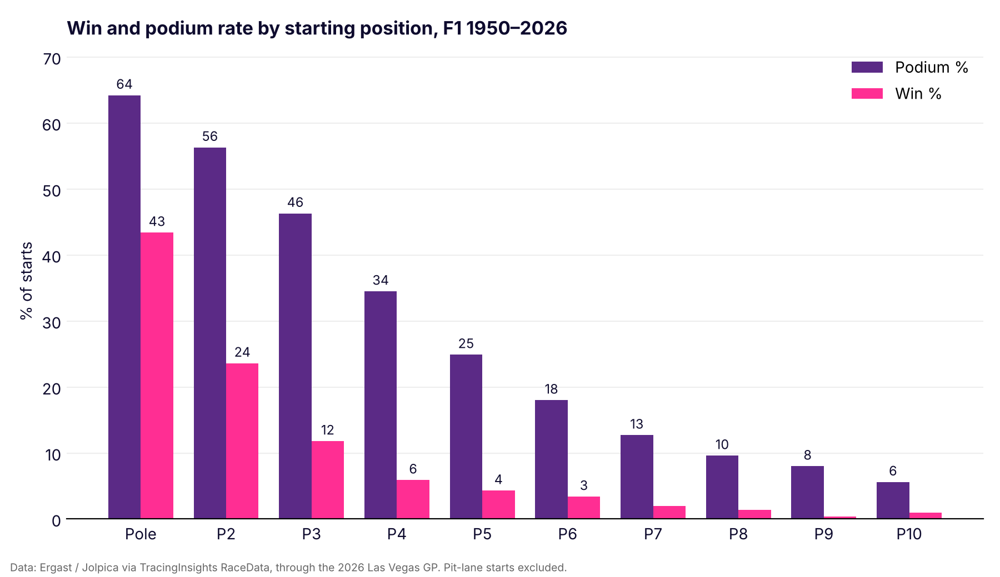

::: {.callout-tip}
## Key finding
Pole wins [43%]{.stat} of F1 races, almost double P2 ([24%]{.stat}). [79%]{.stat} of all wins came from the top 3 on the grid, and only [2.5%]{.stat} from outside the top 10.
:::

## The question

How often does each starting position win or reach the podium in Formula 1, and has that changed across eras and circuits? My [Vegas GP model](../vegas-gp/index.qmd) said starting position mattered most, so I wanted to see how true that is across F1 history.

## The data

The Ergast / Jolpica F1 database via the [TracingInsights RaceData](https://github.com/TracingInsights/RaceData) archive, which covers 1950 through the current season. I loaded 5 tables into MySQL:

| Table | Rows |
| --- | --- |
| results | 27,700 |
| races | 1,172 |
| drivers | 885 |
| status | 143 |
| circuits | 78 |

Results run through the 2026 Las Vegas Grand Prix (1,170 races with results).

**Data quirks I handled:**

- Missing values are stored as the text `\N`, so I converted them to real NULLs on load.
- 1,638 pit-lane starts (`grid = 0`) are excluded, since they have no grid slot.
- 10,953 unclassified results (DNFs) have a NULL position. I counted them as "no win, no podium" with `COALESCE` so `AVG()` doesn't skip them and inflate the rates.
- 3 races from the 1950s have two credited winners, from shared drives. I kept them and flagged them.

## Win and podium rate by grid slot

{fig-alt="Bar chart of win and podium rate by starting position from pole to P10. Pole wins 43% and reaches the podium 64% of the time; P2 wins 24%; P3 wins 12%; from P4 back the win rate falls to 6% or less."}

```sql
CREATE OR REPLACE VIEW race_results AS
SELECT r.race_id, ra.year, ra.name AS race_name, c.name AS circuit,
       CONCAT(d.forename, ' ', d.surname) AS driver,
       r.grid, r.position, s.status,
       COALESCE(r.position = 1, 0)  AS won,
       COALESCE(r.position <= 3, 0) AS podium
FROM results r
JOIN races ra   ON ra.race_id = r.race_id
JOIN circuits c ON c.circuit_id = ra.circuit_id
JOIN drivers d  ON d.driver_id = r.driver_id
JOIN status s   ON s.status_id = r.status_id
WHERE r.grid > 0;

SELECT grid,
       COUNT(*)                    AS starts,
       ROUND(100 * AVG(won), 1)    AS win_pct,
       ROUND(100 * AVG(podium), 1) AS podium_pct
FROM race_results
WHERE grid <= 10
GROUP BY grid
ORDER BY grid;
```

| Start | Win % | Podium % |
| --- | --- | --- |
| Pole | 43.4 | 64.2 |
| P2 | 23.6 | 56.3 |
| P3 | 11.8 | 46.3 |
| P4 | 5.9 | 34.5 |
| P5 | 4.3 | 24.9 |

## Pole matters more than ever

| Decade | Poles | Pole win % | Change |
| --- | --- | --- | --- |
| 1950s | 93 | 37.6 | |
| 1960s | 102 | 36.3 | −1.3 |
| 1970s | 144 | 36.8 | +0.5 |
| 1980s | 156 | 28.2 | −8.6 |
| 1990s | 162 | 42.6 | +14.4 |
| 2000s | 174 | 50.0 | +7.4 |
| 2010s | 198 | 50.5 | +0.5 |
| 2020s | 151 | 57.6 | +7.1 |

In the 2020s, pole converts to a win [57.6%]{.stat} of the time, double the 1980s. I calculated the change with `LAG()` over a CTE.

## Which tracks reward pole?

Among circuits with 10+ races, pole wins most often at Yas Marina and Marina Bay ([70.6%]{.stat} each) and Barcelona ([69.4%]{.stat}). It wins least at Monza ([33.3%]{.stat}) and Silverstone ([36.1%]{.stat}), the classic slipstream tracks. Monaco, famous for being impossible to pass, sits at only [46.6%]{.stat} across 73 races. That's because older eras had far more mechanical retirements.

## The Vegas tie-in

In 2026, Verstappen converted pole into the win and Norris finished P2 from P3. Piastri climbed from P17 to P3, something that happens in under 1% of starts from P17 or lower. My post-qualifying picks (Verstappen, Russell, Norris) got 2 of 3. Russell dropped from P2 to P9.

## Query I'm proudest of

```sql
SELECT CASE WHEN grid = 1 THEN 'Pole'
            WHEN grid <= 3 THEN 'P2-P3'
            WHEN grid <= 10 THEN 'P4-P10'
            ELSE 'P11+' END AS start_zone,
       COUNT(*) AS wins,
       ROUND(100 * COUNT(*) / SUM(COUNT(*)) OVER (), 1) AS pct_of_all_wins
FROM race_results
WHERE won = 1
GROUP BY start_zone
ORDER BY MIN(grid);
```

`SUM(COUNT(*)) OVER ()` runs a window function on top of the grouped counts, so each zone's share of all wins comes out of one query with no subquery. Result: Pole 43.7%, P2–P3 35.4%, P4–P10 18.4%, P11+ 2.5%.

## Limitations

- Field sizes, points systems and reliability changed a lot between eras, so all-time averages blend very different sports.
- Grid position and car speed are tangled together: fast cars qualify well *and* race well. This shows correlation, not how much the grid slot itself is worth.
- A few disqualified drivers keep a finishing position in the source data. None were podiums, so the headline rates aren't affected.

[All SQL scripts on GitHub](https://github.com/toripka-data/toripka-data.github.io/tree/main/projects/f1-sql/sql){.btn .btn-primary}
