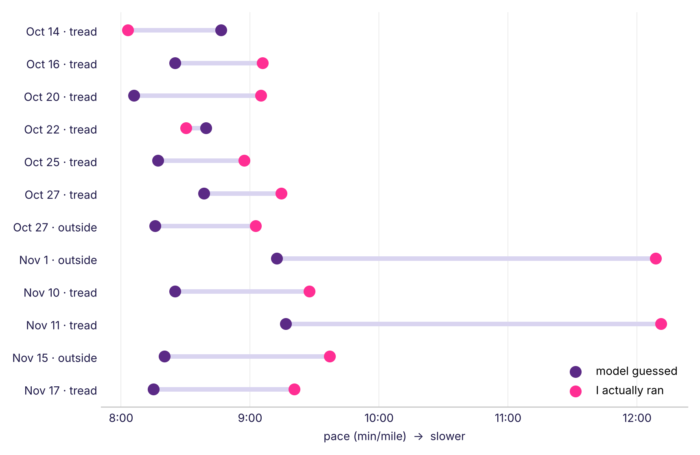

::: {.callout-tip}
## Key finding
The model was off by about [41 sec/mile]{.stat} on runs from its own training period. On 12 new runs it missed by [1:09/mile]{.stat}, and it guessed too fast on 10 of 12. It assumed I'd keep getting faster, and a knee injury and new swim and bike training said otherwise.
:::

## The question

I'm racing my first Ironman 70.3 on July 18, 2027. Can I predict my half-marathon pace from my own training data?

## The data

- [179 runs]{.stat} from Strava, April 2025 to October 12, 2026, all before I started triathlon training (96 treadmill, 83 outside)
- Test set: [12 runs]{.stat} logged on COROS since October 13, 2026, during knee rehab
- Target: average pace in minutes per mile

## The model

A linear regression with six features: distance, average heart rate, treadmill vs outside, elevation gain per mile, trail runs, and weeks of training (a fitness trend).

```{r}
#| eval: false
#| code-summary: "Full model code"
#| file: pace_model.R
```

<!-- To run this live: put strava_runs_clean.csv in this folder, change the
     read_csv() path in pace_model.R if needed, and set eval: true above. -->

## What it learned (per mile)

| Change | Effect on pace |
| --- | --- |
| +10 bpm heart rate | 23 sec faster |
| Each month of training | 8 sec faster |
| Treadmill vs outside | 17 sec slower |
| Trail run | 1:46 slower |
| +1 mile of distance | 3 sec slower |

## The test

{fig-alt="Dot chart of 12 runs from Oct 14 to Nov 17. The model guessed faster than my actual pace on 10 of 12, by about a minute per mile on average, and by about 3 minutes on the easy runs of Nov 1 and Nov 11."}

Why it missed:

1. **It assumed I'd keep getting faster.** The training-weeks trend only ever went one way in my data.
2. **Then life changed.** Knee rehab plus swimming and cycling, none of which the training data had seen.
3. **Some runs were easy on purpose.** My two 12:00/mile runs were planned recovery runs, and the model can't read my training plan.

## My 70.3 prediction

For 13.1 miles outside at 150 bpm, the model says [8:35/mile]{.stat}. Adding back its recent miss gives a realistic range of [9:15–9:35/mile]{.stat}. It still knows nothing about running off the bike.

## Next

In June 2027, one month before race day, I'll retrain it with seven more months of runs and my brick workouts.
